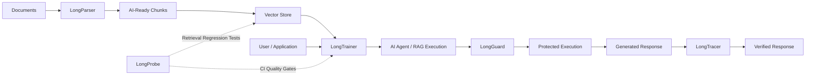

# Long Suite by EnDevSols

**Open-source reliability infrastructure for production RAG systems and AI agents.**

Long Suite is a modular collection of developer tools covering document ingestion, RAG application development, agent runtime protection, response verification, and retrieval regression testing.

Each project is independently installable and maintained, while Long Suite provides the shared architecture, integration guidance, and community hub.

[LongParser](https://github.com/ENDEVSOLS/LongParser) ·
[LongTrainer](https://github.com/ENDEVSOLS/Long-Trainer) ·
[LongGuard](https://github.com/ENDEVSOLS/LongGuard) ·
[LongTracer](https://github.com/ENDEVSOLS/LongTracer) ·
[LongProbe](https://github.com/ENDEVSOLS/LongProbe) ·
[Discussions](https://github.com/ENDEVSOLS/Long-Suite/discussions)

---

## Why Long Suite?

Building a production AI application involves more than connecting an LLM to a vector database.

Teams need to reliably:

- ingest and structure source documents
- build retrieval and agent workflows
- prevent runaway agent executions
- verify generated claims against evidence
- detect retrieval regressions before deployment
- monitor how these components behave as the application evolves

Long Suite separates these responsibilities into focused open-source tools that can be adopted independently or combined into one production workflow.

---

## The Long Suite

| Layer | Project | Purpose |
|---|---|---|
| **Ingest** | [LongParser](https://github.com/ENDEVSOLS/LongParser) | Convert documents into validated, AI-ready chunks for retrieval pipelines |
| **Build** | [LongTrainer](https://github.com/ENDEVSOLS/Long-Trainer) | Build multi-tenant RAG assistants and agent-enabled applications |
| **Guard** | [LongGuard](https://github.com/ENDEVSOLS/LongGuard) | Detect reasoning loops, runaway executions, token spikes, and cost overruns while agents are running |
| **Verify** | [LongTracer](https://github.com/ENDEVSOLS/LongTracer) | Verify generated claims against source documents and detect unsupported responses |
| **Test** | [LongProbe](https://github.com/ENDEVSOLS/LongProbe) | Detect retrieval regressions with golden questions, baselines, chunk-level diffs, and CI checks |

### Production AI lifecycle

```text
Ingest → Build → Guard → Verify → Test
```

The projects are designed to work together, but none of them requires the entire suite.

Use only the components that solve your problem.

---

## Architecture



### Responsibilities

```text
                         LONG SUITE

                   Production AI System

                          │
              ┌───────────┴───────────┐
              │                       │
        Knowledge Layer          Runtime Layer
              │                       │
         LongParser              LongTrainer
              │                       │
              └──────────┬────────────┘
                         │
                         ▼
                     LongGuard
                Runtime protection
                         │
                         ▼
                    LongTracer
                Output verification
                         │
                         ▼
                     LongProbe
                Regression testing
                         │
                         ▼
                       CI/CD
```

---

# Projects

## LongParser

**Document intelligence and ingestion for production RAG pipelines.**

LongParser transforms PDFs, DOCX, PPTX, XLSX, CSV, and other supported documents into structured, AI-ready content.

It focuses on improving the quality of the data that enters retrieval systems.

### Key capabilities

- multi-format document extraction
- hybrid and semantic chunking
- heading and hierarchy-aware chunking
- table-aware processing
- quality validation
- PII redaction
- Human-in-the-Loop review
- LangGraph HITL workflows
- vector-store integrations
- LangChain and LlamaIndex adapters
- FastAPI-based processing workflows

### Typical use cases

- preparing enterprise documents for RAG
- building document ingestion pipelines
- improving chunk quality before embedding
- reviewing low-confidence extraction results
- creating structured knowledge from complex documents

**Repository:**  
https://github.com/ENDEVSOLS/LongParser

---

## LongTrainer

**Production-ready RAG framework for multi-tenant assistants and AI applications.**

LongTrainer provides the application layer for building document-based assistants with retrieval, memory, streaming, tools, and agent workflows.

### Key capabilities

- multi-bot and multi-tenant workflows
- persistent chat memory
- vector retrieval
- streaming responses
- custom tool calling
- LangGraph-based agent mode
- document ingestion
- web-search augmentation
- vision support
- FastAPI server
- CLI workflows
- optional LongTracer integration

### Typical use cases

- enterprise knowledge assistants
- document-based chatbots
- internal support assistants
- multi-tenant AI applications
- RAG APIs
- agent-enabled knowledge systems

**Repository:**  
https://github.com/ENDEVSOLS/Long-Trainer

---

## LongGuard

**In-flight circuit breaker and loop recovery for AI agents.**

LongGuard monitors autonomous agent executions while they are running.

Instead of waiting for a recursion limit or runaway process to fail, LongGuard detects unhealthy execution patterns early and can trigger recovery or terminate the run gracefully.

### Detects

- repeated tool calls
- semantic reasoning oscillation
- dead-end execution drift
- abnormal token velocity
- excessive execution steps
- token-budget overruns
- cost-budget overruns

### Runtime actions

```text
healthy execution
      │
      ▼
   continue

suspicious execution
      │
      ▼
Reflect & Pivot
      │
      ▼
 attempt recovery

recovery fails
      │
      ▼
 graceful stop
```

### Integrations

- LangGraph
- LangChain
- OpenAI SDK
- Anthropic SDK
- custom agent loops

### Typical use cases

- preventing autonomous agents from getting stuck
- limiting runaway LLM costs
- detecting repeated tool execution
- applying hard token or execution budgets
- safely recovering from reasoning loops
- collecting per-run guard telemetry

**Repository:**  
https://github.com/ENDEVSOLS/LongGuard

---

## LongTracer

**Claim-level hallucination detection and response verification for RAG systems.**

LongTracer verifies generated responses against supplied source documents.

Rather than requiring a particular vector database or LLM provider, the core verification API works with response text and source context.

```python
from longtracer import check

result = check(
    response="The Eiffel Tower is located in Berlin.",
    sources=[
        "The Eiffel Tower is located in Paris, France."
    ],
)

print(result.verdict)
print(result.trust_score)
print(result.hallucination_count)
```

### Verification pipeline

```text
Generated Response
       │
       ▼
 Claim Splitting
       │
       ▼
Semantic Matching
       │
       ▼
NLI Verification
       │
       ▼
Trust Score + Verdict
```

### Key capabilities

- claim-level verification
- contradiction detection
- unsupported-claim detection
- trust scoring
- batch verification
- LangChain integration
- LlamaIndex integration
- trace collection
- pluggable trace storage
- OpenTelemetry export
- local dashboards and observability workflows

### Typical use cases

- verifying RAG answers
- detecting unsupported claims
- evaluating source grounding
- monitoring response quality
- adding trust signals to production AI systems

**Repository:**  
https://github.com/ENDEVSOLS/LongTracer

---

## LongProbe

**Fast retrieval regression testing for RAG pipelines.**

LongProbe answers a simple question:

> **Did my latest change break retrieval?**

Define golden questions and expected evidence, run LongProbe after changes, and detect which document chunks were lost or gained.

Think of it as regression testing for the retrieval layer of your RAG application.

### Example workflow

```text
Golden Questions
       │
       ▼
Current Retriever
       │
       ▼
Retrieved Chunks
       │
       ▼
Compare with Baseline
       │
       ├── unchanged
       ├── improved
       └── regression
                 │
                 ▼
              Fail CI
```

### Key capabilities

- golden question test sets
- required chunk validation
- recall scoring
- exact chunk-level diffs
- baseline comparisons
- regression detection
- pytest integration
- GitHub Actions output
- watch mode
- LangChain adapters
- LlamaIndex adapters
- Chroma integration
- Pinecone integration
- Qdrant integration
- HTTP retriever adapter

### Typical use cases

- testing retrieval after changing chunking
- testing embedding upgrades
- validating vector-index migrations
- catching retrieval regressions in pull requests
- maintaining golden datasets
- protecting critical RAG queries

**Repository:**  
https://github.com/ENDEVSOLS/LongProbe

---

# How the Tools Work Together

A complete workflow can look like this:

### 1. Prepare knowledge

Use **LongParser** to extract, validate, review, and chunk source documents.

```text
Documents
   ↓
LongParser
   ↓
AI-ready chunks
```

### 2. Build the application

Index those chunks and use **LongTrainer** to build the RAG assistant or agent application.

```text
AI-ready chunks
   ↓
Vector Store
   ↓
LongTrainer
   ↓
RAG / Agent
```

### 3. Protect runtime execution

Use **LongGuard** around agent execution to detect loops, abnormal behavior, and budget overruns.

```text
Agent
   ↓
LongGuard
   ↓
Protected execution
```

### 4. Verify generated answers

Pass generated responses and their supporting sources through **LongTracer**.

```text
Response + Sources
        ↓
    LongTracer
        ↓
Verified Response
```

### 5. Protect against regressions

Use **LongProbe** in development and CI/CD to make sure retrieval quality does not silently degrade.

```text
Code / Index Change
        ↓
    LongProbe
        ↓
Pass / Regression
        ↓
       CI
```

---

# Use the Projects Independently

Long Suite is modular.

You do **not** need LongTrainer to use LongProbe.

You do **not** need LongParser to use LongTracer.

You do **not** need LangGraph to use LongGuard.

Examples:

```text
Existing RAG application + LongTracer
Existing Pinecone pipeline + LongProbe
Existing LangGraph agent + LongGuard
Existing ingestion system + LongTrainer
Custom application + LongParser
```

Use the smallest part of the suite that solves your problem.

---

# Which Project Should I Use?

| I need to... | Use |
|---|---|
| Parse PDFs, DOCX, PPTX, XLSX, or CSV | **LongParser** |
| Generate AI-ready document chunks | **LongParser** |
| Add HITL document review | **LongParser** |
| Build a document chatbot | **LongTrainer** |
| Build a multi-tenant RAG API | **LongTrainer** |
| Add memory, streaming, or tools | **LongTrainer** |
| Detect an agent stuck in a loop | **LongGuard** |
| Stop runaway token usage | **LongGuard** |
| Set a hard agent cost budget | **LongGuard** |
| Recover a stuck agent before terminating it | **LongGuard** |
| Check whether an answer is supported by sources | **LongTracer** |
| Detect hallucinated or contradicted claims | **LongTracer** |
| Add response trust scoring | **LongTracer** |
| Test whether retrieval changed | **LongProbe** |
| Detect lost chunks after an update | **LongProbe** |
| Add RAG retrieval tests to CI/CD | **LongProbe** |

---

# Long Suite Reliability Model

Long Suite approaches production AI reliability at multiple stages.

| Failure | Long Suite component |
|---|---|
| Poor document extraction | LongParser |
| Bad chunk preparation | LongParser |
| Application orchestration complexity | LongTrainer |
| Agent reasoning loop | LongGuard |
| Repeated tool execution | LongGuard |
| Token or cost runaway | LongGuard |
| Unsupported generated claim | LongTracer |
| Contradiction with source evidence | LongTracer |
| Retrieval quality regression | LongProbe |
| Missing expected evidence | LongProbe |

The goal is not to create one large framework.

The goal is to provide focused tools around common production AI failure modes.

---

# Ecosystem Principles

## Modular

Every Long project is independently installable and versioned.

Use one component or combine several.

## Framework-friendly

The Long Suite is designed to complement existing AI frameworks rather than replace them.

Projects include integrations with technologies such as:

- LangChain
- LangGraph
- LlamaIndex
- OpenAI
- Anthropic
- vector databases
- OpenTelemetry-compatible infrastructure

Integration support varies by project.

## Production-oriented

The projects focus on problems that typically appear after an AI prototype begins moving toward production:

- document quality
- tenant isolation
- persistent state
- runaway execution
- hallucinations
- observability
- regression testing
- CI/CD reliability

## Open source

The Long Suite is developed in public and welcomes bug reports, discussions, feature proposals, integrations, documentation improvements, and code contributions.

---

# Community

For ecosystem-wide questions, architecture discussions, integration ideas, and roadmap proposals, use:

**Long Suite Discussions**

https://github.com/ENDEVSOLS/Long-Suite/discussions

For bugs and package-specific feature requests, use the relevant project repository.

| Project | Issues |
|---|---|
| LongParser | https://github.com/ENDEVSOLS/LongParser/issues |
| LongTrainer | https://github.com/ENDEVSOLS/Long-Trainer/issues |
| LongGuard | https://github.com/ENDEVSOLS/LongGuard/issues |
| LongTracer | https://github.com/ENDEVSOLS/LongTracer/issues |
| LongProbe | https://github.com/ENDEVSOLS/LongProbe/issues |

---

# Contributing

Contributions are welcome across the Long Suite ecosystem.

Good contributions to this central repository include:

- cross-project examples
- architecture documentation
- integration guides
- tutorials
- project comparisons
- documentation corrections
- ecosystem roadmap discussions
- deployment examples

For implementation changes that affect only one package, contribute directly to that project's repository.

| Project | Repository |
|---|---|
| LongParser | https://github.com/ENDEVSOLS/LongParser |
| LongTrainer | https://github.com/ENDEVSOLS/Long-Trainer |
| LongGuard | https://github.com/ENDEVSOLS/LongGuard |
| LongTracer | https://github.com/ENDEVSOLS/LongTracer |
| LongProbe | https://github.com/ENDEVSOLS/LongProbe |

---

# Ecosystem Roadmap

Long Suite development is moving toward tighter interoperability between the individual projects.

Current ecosystem priorities include:

- improving cross-project integration
- standardizing observability and telemetry
- making production failures easier to reproduce as regression tests
- expanding framework adapters
- improving CI/CD workflows
- creating complete end-to-end reference applications
- improving documentation and examples
- strengthening reliability tooling for autonomous AI agents

Major features remain implemented and released through their respective project repositories.

Ecosystem-level proposals belong in:

https://github.com/ENDEVSOLS/Long-Suite/discussions

---

# Repository Scope

This repository is the **central architecture, documentation, examples, and community hub** for Long Suite.

It exists to:

- explain how Long Suite projects fit together
- maintain ecosystem-wide architecture documentation
- provide cross-project examples
- coordinate integration guidance
- centralize ecosystem discussions
- document the overall Long Suite direction

Individual packages remain independently maintained and independently versioned.

---

# Maintained by EnDevSols

Long Suite is maintained by **EnDevSols**.

We build production AI systems, developer infrastructure, automation platforms, and custom software.

Website:

https://endevsols.com/

GitHub:

https://github.com/ENDEVSOLS

---

# License

This Long Suite hub repository is released under the **MIT License**.

Individual Long Suite projects may contain their own licensing or third-party dependency requirements. Check each repository before deployment.
