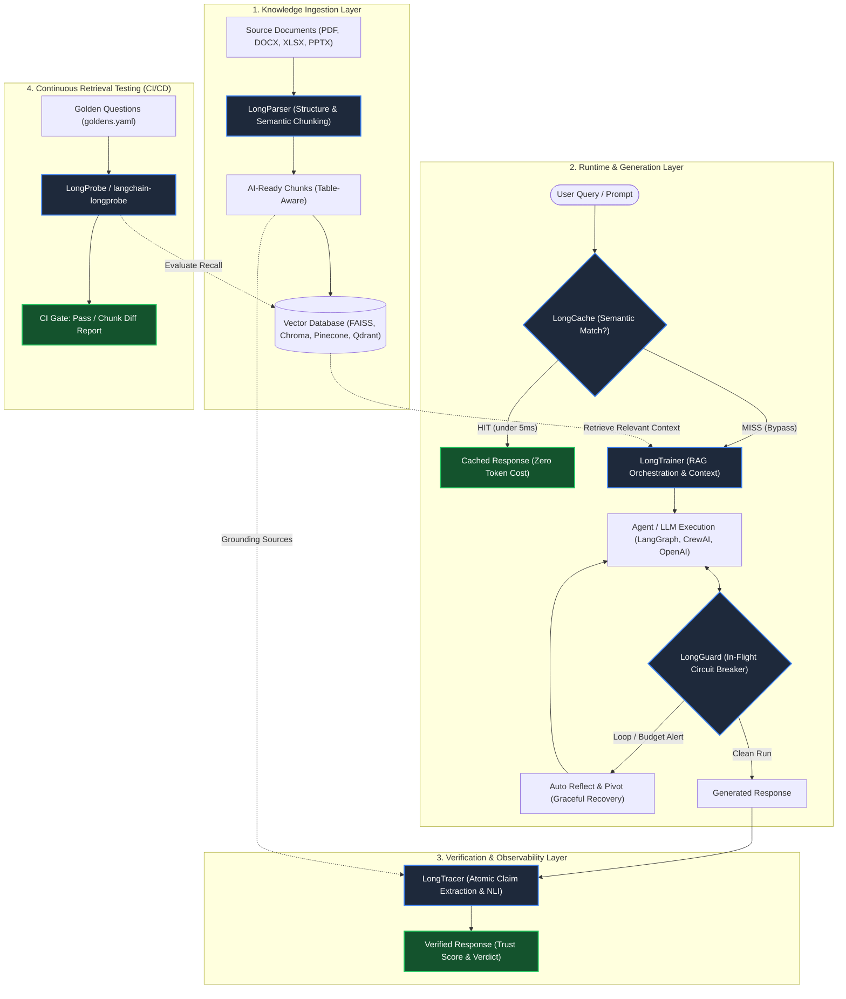

# Long Suite by EnDevSols

<p align="center">
  <a href="https://github.com/ENDEVSOLS/Long-Suite"></a>
  <a href="https://opensource.org/licenses/MIT"></a>
  <a href="https://www.python.org/downloads/"></a>
  <a href="https://github.com/ENDEVSOLS/Long-Suite/discussions"></a>
  <a href="https://endevsols.com/"></a>
</p>

<h3 align="center">
  Modular Reliability Infrastructure & Developer Toolchain for Production RAG and Autonomous AI Agents
</h3>

<p align="center">
  <strong>Long Suite</strong> is a modular, enterprise-grade ecosystem of open-source developer tools engineered to eliminate the most critical failure modes in production Retrieval-Augmented Generation (RAG) and Agentic AI systems: dirty document extraction, redundant LLM token costs, runaway agent reasoning loops, silent hallucinations, and undetected retrieval regressions.
</p>

<p align="center">
  <a href="#the-long-suite"><strong>Explore Suite</strong></a> ·
  <a href="#production-ai-lifecycle"><strong>Lifecycle & Architecture</strong></a> ·
  <a href="#quick-installation"><strong>Quick Install</strong></a> ·
  <a href="#projects"><strong>Projects</strong></a> ·
  <a href="#end-to-end-workflow"><strong>End-to-End Workflow</strong></a> ·
  <a href="#which-project-should-i-use"><strong>Decision Guide</strong></a> ·
  <a href="#framework-compatibility"><strong>Compatibility</strong></a> ·
  <a href="https://github.com/ENDEVSOLS/Long-Suite/discussions"><strong>Discussions</strong></a>
</p>

---

## ⚡ Quick Navigation

| Project | Layer / Role | PyPI Package | GitHub Repository | Documentation |
|:---|:---|:---|:---|:---|
| **LongParser** | Document Intelligence & Ingestion | `pip install longparser` | [ENDEVSOLS/LongParser](https://github.com/ENDEVSOLS/LongParser) | [Docs](https://github.com/ENDEVSOLS/LongParser#readme) |
| **LongTrainer** | RAG Orchestration & Multi-Tenant Assistants | `pip install longtrainer` | [ENDEVSOLS/Long-Trainer](https://github.com/ENDEVSOLS/Long-Trainer) | [Docs](https://github.com/ENDEVSOLS/Long-Trainer#readme) |
| **LongCache** <sup>NEW</sup> | Semantic Similarity Cache (40%+ Cost Reduction) | `pip install longcache` | [ENDEVSOLS/LongCache](https://github.com/ENDEVSOLS/LongCache) | [Docs](https://endevsols.github.io/LongCache/) |
| **LongGuard** <sup>NEW</sup> | In-Flight Agent Circuit Breaker & Loop Recovery | `pip install longguard` | [ENDEVSOLS/LongGuard](https://github.com/ENDEVSOLS/LongGuard) | [Docs](https://endevsols.github.io/LongGuard/) |
| **LongTracer** | Claim-Level Hallucination Detection & NLI Verification | `pip install longtracer` | [ENDEVSOLS/LongTracer](https://github.com/ENDEVSOLS/LongTracer) | [Docs](https://github.com/ENDEVSOLS/LongTracer#readme) |
| **LongProbe** | Sub-Second Retrieval Regression Testing & CI Gates | `pip install longprobe` | [ENDEVSOLS/LongProbe](https://github.com/ENDEVSOLS/LongProbe) | [Docs](https://github.com/ENDEVSOLS/LongProbe#readme) |
| **langchain-longprobe** <sup>INTEGRATION</sup> | Official LangChain Regression Testing Integration | `pip install langchain-longprobe` | [ENDEVSOLS/langchain-longprobe](https://github.com/ENDEVSOLS/langchain-longprobe) | [Docs](https://github.com/ENDEVSOLS/langchain-longprobe#readme) |

---

## Why Long Suite?

Moving a RAG prototype or autonomous AI agent from a Jupyter notebook to enterprise production exposes severe operational bottlenecks:

- **Dirty Ingestion & Fragmented Chunks**: Raw PDFs, PPTXs, and spreadsheets produce disordered chunks, broken tables, and missing headings that permanently degrade embedding quality.
- **Runaway Token Latency & Redundant API Costs**: Semantically identical user queries repeatedly trigger expensive LLM calls, draining budgets and adding unnecessary seconds to response times.
- **Agent Reasoning Loops & Token Overruns**: Autonomous agents easily enter infinite tool-calling loops, oscillating between repetitive prompts until hard recursion limits crash the session.
- **Silent Hallucinations & Unverifiable Answers**: RAG systems generate plausible-sounding responses that directly contradict or lack grounding in source reference documents.
- **Silent Retrieval Regressions**: Upgrading an embedding model, altering chunk overlap, or swapping a vector database silently degrades retrieval recall with zero warning in standard CI.

**Long Suite solves these challenges systematically.** Rather than locking teams into a brittle, monolithic framework, Long Suite separates these operational concerns into focused, best-in-class open-source libraries that you can adopt individually or integrate into a complete, unified pipeline.

---

## The Long Suite

```text
       ┌──────────┐      ┌──────────┐      ┌──────────┐
       │  Ingest  │ ───► │  Cache   │ ───► │  Build   │
       │LongParser│      │LongCache │      │LongTrainer│
       └──────────┘      └──────────┘      └──────────┘
                                                 │
                                                 ▼
       ┌──────────┐      ┌──────────┐      ┌──────────┐
       │   Test   │ ◄─── │  Verify  │ ◄─── │  Guard   │
       │LongProbe │      │LongTracer│      │LongGuard │
       └──────────┘      └──────────┘      └──────────┘
```

| Layer | Project | Role & Purpose | Key Tech |
|:---|:---|:---|:---|
| **1. Ingest** | **[LongParser](https://github.com/ENDEVSOLS/LongParser)** | Transform complex PDFs, DOCX, PPTX, XLSX, and CSV into AI-ready, table-aware, semantic chunks with optional Human-in-the-Loop (HITL) review and PII redaction. | `FastAPI`, `LangGraph`, `Hybrid Chunking` |
| **2. Cache** | **[LongCache](https://github.com/ENDEVSOLS/LongCache)** <sup>NEW</sup> | Production-grade semantic similarity cache for LLM and RAG pipelines. Intercepts paraphrased queries locally with BGE-small and FAISS, slashing repeat API costs and latency by 40%+. | `FAISS`, `BGE-small`, `SQLite`, `Redis`, `Singleflight` |
| **3. Build** | **[LongTrainer](https://github.com/ENDEVSOLS/Long-Trainer)** | Production-ready multi-tenant RAG orchestration framework built on LangChain. Supports persistent MongoDB memory, dynamic tools, agent mode, and streaming. | `LangChain`, `LangGraph`, `FAISS`, `MongoDB` |
| **4. Guard** | **[LongGuard](https://github.com/ENDEVSOLS/LongGuard)** <sup>NEW</sup> | In-flight runtime circuit breaker and reasoning loop recovery for LangGraph, LangChain, CrewAI, and raw client agents. Catches loops early, injects *Reflect & Pivot* prompts, and enforces budget hard caps. | `LangGraph 1.0+`, `CrewAI`, `Loop Detectors`, `Budget Caps` |
| **5. Verify** | **[LongTracer](https://github.com/ENDEVSOLS/LongTracer)** | Claim-level hallucination detection and response verification. Breaks LLM responses into atomic assertions and verifies grounding against source context using hybrid STS + NLI. | `NLI`, `STS`, `OpenTelemetry`, `Trust Scoring` |
| **6. Test** | **[LongProbe](https://github.com/ENDEVSOLS/LongProbe)** | Sub-second retrieval regression testing. Define golden question datasets to catch lost chunks and recall drops in CI/CD before shipping retriever or index changes. | `pytest`, `Chunk-Level Diffs`, `GitHub Actions` |
| **Companion** | **[langchain-longprobe](https://github.com/ENDEVSOLS/langchain-longprobe)** | Official LangChain integration package for LongProbe. Enables 1-line regression tests for any LangChain retriever. | `LangChain`, `pytest-longprobe` |

---

## Production AI Lifecycle

```text
Ingest → Cache → Build → Guard → Verify → Test
```

Every project in the Long Suite is decoupled: use one component to solve a specific bottleneck in an existing architecture, or combine them for end-to-end production reliability.

---

## Architecture & Data Flow



### System Responsibilities

```text
                                 LONG SUITE
                       Open-Source Production AI Stack

                                      │
            ┌─────────────────────────┼─────────────────────────┐
            ▼                         ▼                         ▼
       [Knowledge]             [Cost & Latency]           [Application]
       LongParser                 LongCache                LongTrainer
    (Document Parsing)        (Semantic Cache)           (RAG Assistant)
            │                         │                         │
            └─────────────────────────┼─────────────────────────┘
                                      │
                                      ▼
                                  LongGuard
                            (Runtime Protection)
                                      │
                                      ▼
                                 LongTracer
                            (Output Verification)
                                      │
                                      ▼
                         LongProbe / langchain-longprobe
                              (Regression Testing)
                                      │
                                      ▼
                             CI/CD Quality Gate
```

---

## Quick Installation

Every package in the Long Suite is published on PyPI, strictly versioned, and installable independently:

```bash
# 1. Document Ingestion
pip install longparser

# 2. Multi-Tenant RAG Orchestration
pip install longtrainer

# 3. Semantic Similarity Cache (with LangChain & Redis options)
pip install longcache
# Optional extras: pip install "longcache[langchain]" or "longcache[redis]"

# 4. Agent Circuit Breaker & Loop Recovery
pip install longguard

# 5. Hallucination Detection & Claim Verification
pip install longtracer

# 6. Retrieval Regression Testing
pip install longprobe
# Official LangChain integration:
pip install langchain-longprobe
```

Or install using modern package managers like `uv`:
```bash
uv pip install longparser longtrainer longcache longguard longtracer longprobe langchain-longprobe
```

---

# Projects

## LongCache <sup>NEW</sup>
### Production-Grade Semantic Similarity Cache for LLM and RAG Pipelines

[](https://pypi.org/project/longcache/)
[](https://endevsols.github.io/LongCache/)
[](https://opensource.org/licenses/MIT)

> *"What is your refund policy?" costs $0.03 the first time. It should cost $0.00 every time after that.*

Traditional string-matching caches fail on paraphrased user queries. **LongCache** computes local dense vector representations (using `BAAI/bge-small-en-v1.5`) and queries an in-process FAISS index to match semantically equivalent queries in under 5 milliseconds.

```python
from longcache import LongCache, RequestContext, RequestScope

# Configure isolated tenant and model execution context
context = RequestContext(
    scope=RequestScope(tenant_id="enterprise-org", user_id="user-42"),
    operation="rag.qa",
    provider="openai",
    model="gpt-4o",
    prompt_version="v2.1",
    corpus_version="kb-2026-q4",
)
cache = LongCache(context=context)

@cache.cached(similarity_threshold=0.92, ttl=86400)
def query_rag_pipeline(query: str) -> str:
    # Your full ingestion + retrieval + LLM call
    return my_expensive_rag_chain(query)

# Call 1: MISS -> Executes full LLM pipeline (~1200ms, $0.03)
ans1 = query_rag_pipeline("What are the cancellation terms?")

# Call 2 (Paraphrase): HIT -> Served from cache (3ms, $0.00)
ans2 = query_rag_pipeline("How do I cancel my subscription?")
```

### Key Capabilities
- **40%+ Token Cost Reduction**: Intercepts repetitive and paraphrased queries before they touch paid LLM APIs.
- **Offline Local Embeddings**: Bundles `BGE-small` for fast, free, local embedding generation without API network overhead.
- **Singleflight Stampede Protection**: Coalesces concurrent identical requests into a single in-flight leader to prevent backend thundering herds.
- **Multi-Tenant Isolation**: Cryptographic request isolation ensures cross-tenant or cross-model cache poisoning is impossible.
- **Pluggable Backends**: Runs seamlessly on embedded SQLite, persistent Redis, or in-memory storage.

### Typical Use Cases
- High-volume customer support and FAQ chatbots
- Enterprise search portals with frequent repeat or rephrased questions
- Reducing third-party LLM inference bills and API rate-limit bottlenecks
- Slashing latency from ~1200ms down to sub-5ms for warm queries

**Repository:** [https://github.com/ENDEVSOLS/LongCache](https://github.com/ENDEVSOLS/LongCache)

---

## LongGuard <sup>NEW</sup>
### In-Flight Circuit Breaker & Loop Recovery for Autonomous AI Agents

[](https://pypi.org/project/longguard/)
[](https://endevsols.github.io/LongGuard/)
[](https://opensource.org/licenses/MIT)

> *"Why did my agent just burn $15 repeating the exact same search 20 times?"*

When autonomous LLM agents encounter ambiguous inputs or unexpected tool results, they frequently get trapped in reasoning loops: repeating identical tool calls, oscillating between conflicting states, or drifting aimlessly. Standard recursion limits abruptly crash execution (`GraphRecursionError`), dropping all state. **LongGuard** acts as an intelligent runtime circuit breaker that intercepts loops in-flight, injects a **"Reflect & Pivot"** prompt to self-correct the agent, and enforces hard token/cost caps.

```python
from langgraph.prebuilt import create_react_agent
from longguard import add_guard_to_graph, GuardConfig

# Initialize standard LangGraph agent
app = create_react_agent(model, tools=my_tools)

# Wrap with LongGuard in 1 line
guarded_app = add_guard_to_graph(
    app,
    config=GuardConfig(
        max_cost_dollars=2.00,        # Hard financial circuit breaker
        max_tool_repetitions=3,       # Catch repetitive tool loops
        action_on_trip="reflect",     # Auto-inject "Reflect & Pivot" prompt
        verbose=True
    )
)

# If the agent loops, LongGuard injects corrective guidance without crashing
result = guarded_app.invoke({"messages": [("user", "Analyze Q4 revenue discrepancies")]})
```

### Key Capabilities
- **Sub-Millisecond Monitoring**: Zero perceptible latency added to LLM step execution.
- **4 Real-Time Loop Detectors**: Detects exact tool repetition, semantic reasoning oscillation, execution drift, and token velocity spikes.
- **Reflect & Pivot Prompt Injection**: Automatically prompts the agent to diagnose its deadlock and select an alternative execution path.
- **Hard Cost & Token Caps**: Prevents runaway billing by enforcing strict per-session dollar and token budgets.
- **Turnkey Framework Integrations**: Native support for **LangGraph 1.0+**, **LangChain**, **CrewAI**, and raw OpenAI/Anthropic client loops.

### Typical Use Cases
- Autonomous coding, data analysis, and web browsing agents
- Long-running multi-agent pipelines where an unhandled loop stalls execution
- Setting hard financial ceilings on open-ended customer-facing agent runs
- Safely recovering stuck agents rather than crashing user conversations

**Repository:** [https://github.com/ENDEVSOLS/LongGuard](https://github.com/ENDEVSOLS/LongGuard)

---

## LongParser
### Privacy-First Document Intelligence Engine for Production RAG Pipelines

[](https://pypi.org/project/longparser/)
[](https://opensource.org/licenses/MIT)

Garbage in, garbage out: retrieval accuracy is fundamentally bounded by document extraction quality. **LongParser** transforms complex multi-page PDFs, DOCX files, presentations, spreadsheets, and scanned documents into structured, AI-ready chunk representations with preserved table structures, layout awareness, and PII redaction.

```python
from longparser import DocumentParser, ChunkingConfig

parser = DocumentParser(
    chunking_config=ChunkingConfig(
        strategy="hierarchical",      # Respect document outline & section hierarchy
        max_chunk_size=512,
        preserve_tables=True,         # Convert complex tables into clean Markdown/JSON
        redact_pii=True               # Strip emails, phone numbers, and SSNs locally
    )
)

# Parse document with structural preservation
parsed_doc = parser.parse("annual_financial_report.pdf")

for chunk in parsed_doc.chunks:
    print(f"Header: {chunk.metadata.heading_path}")
    print(f"Content: {chunk.text[:120]}...\n")
```

### Key Capabilities
- **Multi-Format Extraction**: Unified parsing for PDF, DOCX, PPTX, XLSX, and CSV.
- **Table-Aware Semantic Chunking**: Converts financial and data tables into structured Markdown tables rather than disorganized character blobs.
- **Human-in-the-Loop (HITL) Review**: Built-in LangGraph review workflows allow human validation of low-confidence optical extractions.
- **Privacy & PII Protection**: Local redaction ensures sensitive customer data never leaves your infrastructure.
- **Production FastAPI Microservice**: Ready to run as a scalable microservice in containerized environments.

### Typical Use Cases
- Ingesting complex financial statements, contracts, manuals, and enterprise spreadsheets
- Preprocessing documents before vector embedding to maximize retrieval precision
- Automated redaction of sensitive customer and employee identifiers
- Enterprise document pipelines requiring human review gates for low-confidence scans

**Repository:** [https://github.com/ENDEVSOLS/LongParser](https://github.com/ENDEVSOLS/LongParser)

---

## LongTrainer
### Enterprise RAG Framework for Multi-Tenant Chatbots and Autonomous Applications

[](https://pypi.org/project/longtrainer/)
[](https://opensource.org/licenses/MIT)

**LongTrainer** provides the enterprise application layer for building multi-tenant RAG assistants. Built on top of LangChain, it packages isolated vector indexes, persistent MongoDB session memory, live token streaming, custom tool orchestration, and agent modes into an intuitive, production-hardened API.

```python
from longtrainer import LongTrainer

# Initialize multi-tenant RAG orchestrator
trainer = LongTrainer(mongo_endpoint="mongodb://localhost:27017")

# Create an isolated bot workspace
bot_id = trainer.initialize_bot(bot_name="LegalAdvisor")

# Ingest knowledge documents into bot's isolated FAISS index
trainer.add_document(bot_id=bot_id, file_path="compliance_policy.pdf")

# Stream context-aware responses with persistent conversation memory
for token in trainer.chat(bot_id=bot_id, session_id="user_sess_101", query="What are the disclosure rules?"):
    print(token, end="", flush=True)
```

### Key Capabilities
- **Multi-Tenant Bot Architecture**: Complete isolation between different organizations, bots, and user data stores.
- **Persistent Chat Memory**: Seamless MongoDB conversation history with automatic contextual summarization.
- **Streaming & Tool Calling**: Native WebSocket/SSE response streaming and function-calling integration.
- **Integrated Agent Mode**: Built-in LangGraph agent workflows for multi-step reasoning over internal knowledge bases.

### Typical Use Cases
- Multi-tenant enterprise SaaS applications serving separate client knowledge bases
- Production chatbots requiring persistent, stateful memory and streaming UI responses
- Custom internal AI assistants with role-based access control and isolated vector stores
- Autonomous knowledge agents executing tool calls against enterprise databases

**Repository:** [https://github.com/ENDEVSOLS/Long-Trainer](https://github.com/ENDEVSOLS/Long-Trainer)

---

## LongTracer
### Claim-Level Hallucination Detection & Verification for RAG Systems

[](https://pypi.org/project/longtracer/)
[](https://opensource.org/licenses/MIT)

LLM judges are slow, costly, and frequently hallucinate their own evaluations. **LongTracer** verifies generated responses by breaking them into atomic claims and cross-verifying each statement against retrieved context documents using hybrid Semantic Textual Similarity (STS) and Natural Language Inference (NLI).

```python
from longtracer import check

# Verify generated response against source context
result = check(
    response="The contract requires net 30 payment terms and incurs a 5% monthly late fee.",
    sources=[
        "All invoices are payable within 30 days of receipt (Net 30). Late balances accrue interest at 1.5% per month."
    ]
)

print(f"Verdict: {result.verdict}")                        # CONTRADICTION / PARTIALLY_SUPPORTED
print(f"Trust Score: {result.trust_score:.2f}")            # e.g., 0.50
print(f"Contradictions: {result.contradiction_count}")     # 1 (5% fee != 1.5% interest)
for claim in result.claims:
    print(f"Claim: '{claim.text}' -> {claim.status}")
```

### Key Capabilities
- **Atomic Claim Extraction**: Automatically decomposes complex compound sentences into verifiable assertions.
- **Dual Verification Engine**: Combines cross-encoder NLI (Entailment / Contradiction / Neutral) with dense semantic matching.
- **Trust Scoring Metric**: Computes a continuous `0.0 - 1.0` confidence score for every generated response.
- **Observability & OpenTelemetry**: Exports detailed verification spans to Jaeger, Datadog, or custom dashboards.

### Typical Use Cases
- High-stakes RAG applications in healthcare, legal, finance, and technical documentation
- Real-time hallucination prevention guardrails before displaying answers to end-users
- Automated evaluation and benchmarking of RAG response fidelity
- Providing continuous trust and citation scores alongside generated answers

**Repository:** [https://github.com/ENDEVSOLS/LongTracer](https://github.com/ENDEVSOLS/LongTracer)

---

## LongProbe & langchain-longprobe
### Sub-Second Retrieval Regression Testing & CI Quality Gates

[](https://pypi.org/project/longprobe/)
[](https://pypi.org/project/langchain-longprobe/)
[](https://opensource.org/licenses/MIT)

> *"Did our latest chunking tweak or embedding model migration break retrieval for our key customers?"*

**LongProbe** brings test-driven development to the RAG retrieval layer. By defining "Golden Questions" and their required chunks, LongProbe executes automated regression checks in milliseconds, generating chunk-level diffs and failing CI if retrieval accuracy drops.

```yaml
# goldens.yaml - Define retrieval expectations
name: "customer-support-goldens"
version: "1.0"
questions:
  - id: "q_refund_policy"
    question: "What is the return window for hardware devices?"
    match_mode: "id"
    required_chunks:
      - "chunk_hardware_return_30days"
    top_k: 5
```

```python
# test_retrieval.py - Run in pytest / CI
from langchain_longprobe import RetrievalProbe
from my_app import get_production_retriever

def test_retrieval_quality():
    retriever = get_production_retriever()
    probe = RetrievalProbe.from_retriever(retriever=retriever, goldens_path="goldens.yaml")
    
    report = probe.run()
    assert report.pass_rate == 1.0, f"Retrieval regressed! Lost chunks: {probe.get_missing_chunks()}"
```

### Key Capabilities
- **Sub-Second Execution**: Evaluates dozens of golden queries without calling slow, expensive LLM evaluators.
- **Visual Chunk-Level Diffs**: Pinpoints the exact chunks that were dropped or displaced after index modifications.
- **Pytest & GitHub Actions Ready**: Native test runner integration to block bad retriever code before it hits production.
- **Official LangChain Adapter (`langchain-longprobe`)**: Drop-in evaluation support for any standard `BaseRetriever`.

### Typical Use Cases
- Testing retrieval accuracy after updating embedding models or chunk sizes
- Continuous integration gates in GitHub Actions to prevent broken retriever merges
- Maintaining curated golden test sets for enterprise RAG benchmarks
- Visualizing chunk retrieval drift across production vector index rebuilds

**Repositories:**
- Core Engine: [https://github.com/ENDEVSOLS/LongProbe](https://github.com/ENDEVSOLS/LongProbe)
- LangChain Adapter: [https://github.com/ENDEVSOLS/langchain-longprobe](https://github.com/ENDEVSOLS/langchain-longprobe)

---

## End-to-End Workflow: The Unified Pipeline

Here is how all components seamlessly combine to deliver an enterprise-grade, high-reliability AI application:

```python
# ==============================================================================
# Complete Production RAG Pipeline Powered by Long Suite
# ==============================================================================

# 1. INGESTION (LongParser)
from longparser import DocumentParser
parser = DocumentParser(preserve_tables=True)
chunks = parser.parse("enterprise_knowledge.pdf").chunks

# 2. CACHING (LongCache)
from longcache import LongCache, RequestContext, RequestScope
context = RequestContext(
    scope=RequestScope(tenant_id="tenant-acme", user_id="user-01"),
    operation="support.qa",
    model="gpt-4o",
)
cache = LongCache(context=context)

# 3. RUNTIME & ORCHESTRATION (LongTrainer + LongGuard)
from longtrainer import LongTrainer
from longguard import add_guard_to_graph, GuardConfig

trainer = LongTrainer()
bot_id = trainer.initialize_bot(bot_name="EnterpriseAssistant")

# Decorate retrieval execution with LongCache
@cache.cached(similarity_threshold=0.92, ttl=3600)
def execute_safe_query(user_query: str) -> str:
    # Protect agent runtime with LongGuard
    guarded_agent = add_guard_to_graph(
        trainer.get_agent(bot_id),
        config=GuardConfig(max_cost_dollars=1.50, action_on_trip="reflect")
    )
    raw_answer, source_chunks = guarded_agent.invoke_with_sources(user_query)
    
    # 4. VERIFICATION (LongTracer)
    from longtracer import check
    verification = check(response=raw_answer, sources=source_chunks)
    
    if verification.verdict == "CONTRADICTION":
        return "I apologize, but the retrieved information could not reliably substantiate this answer."
    
    return raw_answer

# 5. REGRESSION CI (LongProbe)
# In your CI pipeline: pytest tests/test_retrieval.py (using LongProbe or langchain-longprobe)
```

---

## Use the Projects Independently

Long Suite is completely modular. You do **not** need to adopt the entire suite to gain immediate production value. Adopt only the component that targets your current production pain point:

```text
Existing LangGraph Agent        + LongGuard   --> Zero reasoning loops & budget overruns
Existing Pinecone / Chroma RAG  + LongCache   --> 40%+ token cost savings & sub-5ms answers
Existing Enterprise Pipeline    + LongTracer  --> Real-time hallucination prevention
Existing Production Retriever   + LongProbe   --> Sub-second CI regression testing
Raw PDF / Document Ingestion    + LongParser  --> Clean, table-aware chunk preparation
Multi-Tenant SaaS Bot Need      + LongTrainer --> Turnkey isolated assistants with memory
```

---

## Which Project Should I Use?

| Engineering Need / Failure Mode | Recommended Tool | Why It Solves It |
|:---|:---|:---|
| Complex PDFs, DOCX, or tables losing structure during chunking | **LongParser** | Hierarchy-aware extraction with table preservation & PII redaction |
| High LLM API bills caused by repeated or paraphrased user queries | **LongCache** | Local BGE-small semantic similarity cache with sub-5ms FAISS lookup |
| Building multi-tenant RAG assistants with persistent memory & streaming | **LongTrainer** | Turnkey RAG framework built on LangChain with isolated MongoDB memory |
| AI agent stuck in tool-calling loops, oscillating, or exceeding budget | **LongGuard** | In-flight runtime circuit breaker with auto Reflect & Pivot prompt injection |
| Model generating hallucinated claims or contradicting retrieved sources | **LongTracer** | Claim-level NLI verification and continuous response trust scoring |
| Retriever silently dropping vital document chunks after code or index changes | **LongProbe** | Sub-second CI regression testing with golden datasets and chunk-level diffing |
| LangChain retriever regression testing in pytest | **langchain-longprobe** | 1-line integration for any LangChain `BaseRetriever` |

---

## Long Suite Reliability Matrix

| Failure Mode | Production Impact | Long Suite Solution | Mitigation Mechanism |
|:---|:---|:---|:---|
| **Disordered Ingestion** | Incoherent embeddings, broken tabular data | **LongParser** | Structural heading trees, Markdown table conversion |
| **Cache Stampedes / Query Duplication** | Thousands in wasted LLM fees, slow response times | **LongCache** | Local BGE-small embeddings, singleflight concurrency locks |
| **State & Memory Bleed** | Cross-tenant data leakage in enterprise bots | **LongTrainer** | Strictly scoped tenant workspaces and isolated vector indexes |
| **Agent Reasoning Loops** | Frozen chat interfaces, astronomical token bills | **LongGuard** | Semantic oscillation detection, Reflect & Pivot injection, budget caps |
| **Hallucinated Statements** | Compliance risks, customer mistrust | **LongTracer** | Atomic claim decomposition, hybrid STS + NLI source verification |
| **Silent Retrieval Regressions** | Production degradation after index updates | **LongProbe** | Deterministic recall testing in CI with golden chunk assertion |

---

## Framework Compatibility

The Long Suite tools are engineered to be modular and framework-agnostic, integrating out-of-the-box with modern AI stacks:

- **Orchestration Frameworks**: [LangChain](https://github.com/langchain-ai/langchain), [LangGraph](https://github.com/langchain-ai/langgraph), [LlamaIndex](https://github.com/run-llama/llama_index), [CrewAI](https://github.com/crewAIInc/crewAI)
- **Model Providers**: [OpenAI](https://platform.openai.com/), [Anthropic](https://www.anthropic.com/), [Google Gemini](https://ai.google.dev/), [Hugging Face](https://huggingface.co/)
- **Vector Stores & Indexes**: [FAISS](https://github.com/facebookresearch/faiss), [ChromaDB](https://www.trychroma.com/), [Pinecone](https://www.pinecone.io/), [Qdrant](https://qdrant.tech/), [Milvus](https://milvus.io/)
- **Caches & Databases**: [SQLite](https://sqlite.org/), [Redis](https://redis.io/), [MongoDB](https://www.mongodb.com/)
- **Observability & Testing**: [OpenTelemetry](https://opentelemetry.io/), [pytest](https://docs.pytest.org/), [FastAPI](https://fastapi.tiangolo.com/)

---

## Community & Discussions

Long Suite is maintained openly, and we encourage architectural contributions, feature requests, and community discussions:

- **Ecosystem Discussions & Roadmap**: [Long-Suite Discussions](https://github.com/ENDEVSOLS/Long-Suite/discussions)
- **Issue Trackers**:
  - [LongParser Issues](https://github.com/ENDEVSOLS/LongParser/issues)
  - [LongTrainer Issues](https://github.com/ENDEVSOLS/Long-Trainer/issues)
  - [LongCache Issues](https://github.com/ENDEVSOLS/LongCache/issues)
  - [LongGuard Issues](https://github.com/ENDEVSOLS/LongGuard/issues)
  - [LongTracer Issues](https://github.com/ENDEVSOLS/LongTracer/issues)
  - [LongProbe Issues](https://github.com/ENDEVSOLS/LongProbe/issues)
  - [langchain-longprobe Issues](https://github.com/ENDEVSOLS/langchain-longprobe/issues)

---

## Contributing

We welcome community contributions across the entire ecosystem. If you are submitting:
- Cross-project examples, tutorials, or architecture guides: please contribute directly to this [Long-Suite](https://github.com/ENDEVSOLS/Long-Suite) repository.
- Core feature enhancements, bug fixes, or framework adapters: please submit a pull request directly to the individual project's repository.

---

## About EnDevSols

Long Suite is proudly developed and maintained by **[EnDevSols](https://endevsols.com/)**.

We specialize in production-grade AI systems, generative AI infrastructure, autonomous agent orchestration, and enterprise software engineering.

- **Website**: [https://endevsols.com/](https://endevsols.com/)
- **GitHub**: [https://github.com/ENDEVSOLS](https://github.com/ENDEVSOLS)

---

## License

This Long Suite hub repository is open-sourced under the **[MIT License](LICENSE)**. Individual projects within the Long Suite ecosystem are released under their respective open-source licenses (MIT or Apache 2.0).
